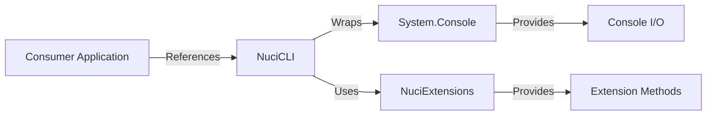
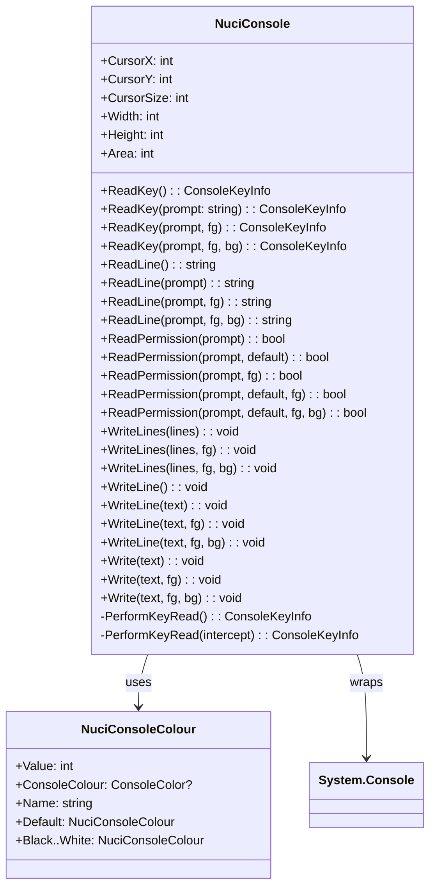
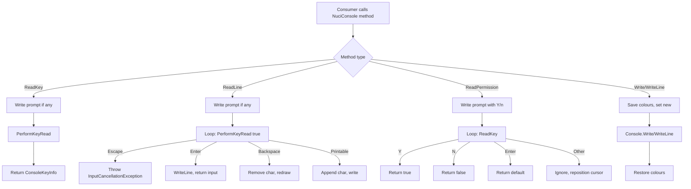
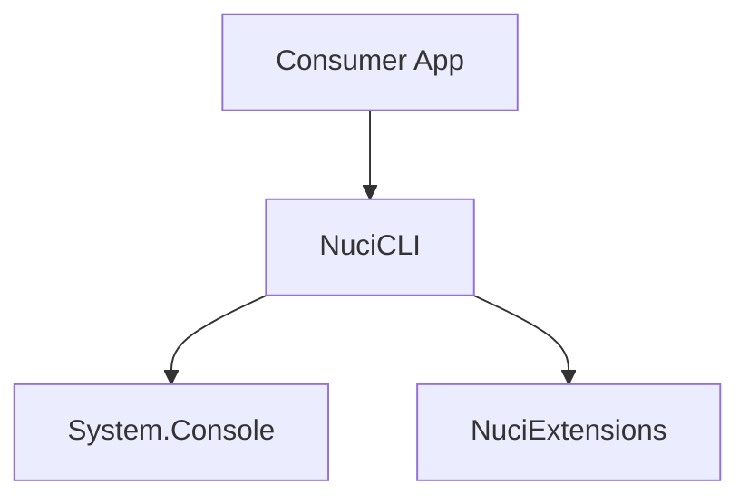

# NuciCLI Architecture

This document describes the current architecture of NuciCLI, a lightweight .NET library for building interactive command-line applications.

## 📑 Table of Contents

- [Purpose](#-purpose)
- [System Context](#-system-context)
- [Architectural Style](#-architectural-style)
- [Runtime Flow](#-runtime-flow)
- [Components](#-components)
- [Architectural Areas](#-architectural-areas)
- [Interfaces and Integrations](#-interfaces-and-integrations)
- [Cross-Cutting Concerns](#-cross-cutting-concerns)
- [Dependency Direction and Rules](#-dependency-direction-and-rules)
- [External Dependencies](#-external-dependencies)
- [Deployment and Operations](#-deployment-and-operations)
- [Compatibility Contracts](#-compatibility-contracts)
- [Testing and Verification](#-testing-and-verification)
- [Design Constraints](#-design-constraints)
- [Source Map](#-source-map)
- [Related Documentation](#-related-documentation)

## 🎯 Purpose

NuciCLI provides a minimal, focused API for common console operations: prompted text input, single-key input, yes/no confirmation prompts, coloured output, and cursor/buffer dimension access. It is designed as a lightweight foundation for richer CLI tooling, with no external runtime dependencies beyond the .NET base class library and NuciExtensions.

## 🌐 System Context



The principal external boundaries are:
- **Consumer Application:** References NuciCLI via NuGet or project reference; initiates all interactions.
- **System.Console (BCL):** Provides low-level console I/O, cursor control, and colour management.
- **NuciExtensions:** Supplies extension methods used internally (e.g., `IsNullOrEmpty` checks).

## 🏗️ Architectural Style

NuciCLI follows a **static façade** pattern over `System.Console`. All members are `static` on `NuciConsole` and `NuciConsoleColour`; there is no instance state, no dependency injection, and no composition root. The library is a single assembly (`NuciCLI.dll`) with no internal layering.



The principal architecture boundaries are:
- **Public API Surface (`NuciConsole`, `NuciConsoleColour`):** All consumer-facing members; no internal types exposed.
- **Private Implementation (`PerformKeyRead`):** Internal helper for key reading with `TreatControlCAsInput` toggling.

## 🔄 Runtime Flow



The principal runtime sequence is:
1. Consumer invokes a `NuciConsole` static method.
2. Method writes prompt (if applicable) via `Write`/`WriteLine`.
3. For input methods, `PerformKeyRead` loops until a terminating key (`Enter`, `Escape`, `Y`, `N`).
4. Coloured output methods temporarily replace `Console.ForegroundColor`/`BackgroundColor`, write, then restore.
5. Result returned or exception thrown (`InputCancellationException` on `Escape` during `ReadLine`).

## 🧩 Components

| Component | Responsibility | Principal Dependencies | Lifetime or Ownership |
|-----------|----------------|------------------------|-----------------------|
| `NuciConsole` | Static façade for all console interactions: input, output, cursor, dimensions | `System.Console`, `NuciConsoleColour`, `NuciExtensions` | Stateless; owned by NuciCLI assembly |
| `NuciConsoleColour` | Immutable colour descriptors mapping to `ConsoleColor` | `System.ConsoleColor` | Stateless; owned by NuciCLI assembly |
| `InputCancellationException` | Signals user cancellation via `Escape` during `ReadLine` | `System.Exception` | Thrown by `NuciConsole.ReadLine`; caught by consumer |

## 🗂️ Architectural Areas

### Core Library (`NuciCLI/`)

Paths:
- `NuciCLI/NuciConsole.cs`
- `NuciCLI/NuciConsoleColour.cs`
- `NuciCLI/InputCancellationException.cs`
- `NuciCLI/NuciCLI.csproj`

Responsibilities:
- All public API surface
- Console interaction logic
- Colour abstraction
- Cancellation signalling

Boundary rules:
- No dependencies on consumer code
- No internal layering; single assembly
- Public types only: `NuciConsole`, `NuciConsoleColour`, `InputCancellationException`

### Unit Tests (`NuciCLI.UnitTests/`)

Paths:
- `NuciCLI.UnitTests/NuciCLI.UnitTests.csproj`

Responsibilities:
- Verify `NuciConsole` behaviour
- Test input, output, colour, cancellation paths

Boundary rules:
- References `NuciCLI` project only
- No production code in test project

## 🔌 Interfaces and Integrations

| Interface or Integration | Direction | Contract | Owner | Failure Semantics |
|--------------------------|-----------|----------|-------|-------------------|
| `NuciConsole` static methods | Inbound (consumer calls) | .NET method signatures; `ConsoleKeyInfo`, `string`, `bool` returns; `InputCancellationException` | `NuciConsole` | Exceptions propagate; `InputCancellationException` for `Escape` |
| `System.Console` | Outbound (wrapped) | `Console.ReadKey`, `Console.Write`, `Console.WriteLine`, `Console.CursorLeft`, `Console.CursorTop`, `Console.SetCursorPosition`, `Console.BufferWidth`, `Console.BufferHeight`, `Console.CursorSize`, `Console.ForegroundColor`, `Console.BackgroundColor`, `Console.TreatControlCAsInput` | BCL | Exceptions propagate (e.g., `IOException` on redirected I/O) |
| `NuciExtensions` | Outbound (used) | Extension methods (e.g., `IsNullOrEmpty`) | NuciExtensions package | Exceptions propagate |

## 🧵 Cross-Cutting Concerns

### Error Handling

- `InputCancellationException` is the only library-defined exception; thrown exclusively by `ReadLine` overloads when the user presses `Escape`.
- All other failures (I/O errors, invalid console state) surface as standard .NET exceptions from `System.Console` and are not caught or translated.
- No retry, fallback, or degradation logic exists; the library assumes a functional interactive console.

### Configuration

No configuration system exists. Behaviour is determined entirely by method parameters. Colour defaults to `NuciConsoleColour.Default` (no colour change).

### Concurrency and Resource Use

- Not thread-safe. `System.Console` is process-wide shared state; concurrent calls from multiple threads will interleave output and input unpredictably.
- No resource acquisition beyond console handles; no disposal required.
- No async APIs; all methods are synchronous blocking calls.

## 🧭 Dependency Direction and Rules



The principal dependency rules are:
- **Consumer → NuciCLI:** Only permitted direction for consumer code.
- **NuciCLI → BCL:** Internal wrapping; no abstraction layer.
- **NuciCLI → NuciExtensions:** Internal use of extension methods.
- **Prohibited:** NuciCLI must not depend on consumer code, test code, or any UI framework.

## 📦 External Dependencies

| Dependency | Responsibility | Integration Boundary | Architectural Consequence |
|------------|----------------|----------------------|---------------------------|
| `System.Console` (BCL) | Low-level console I/O, cursor, colour | Direct static calls in `NuciCLI` | Tied to .NET runtime console subsystem; behaviour varies by terminal/OS |
| `NuciExtensions` (6.0.2) | Extension methods (e.g., `IsNullOrEmpty`) | `using NuciExtensions;` in `NuciConsole.cs` | Single package dependency; version pinned in csproj |

## 🚀 Deployment and Operations

| Concern | Current Design | Architectural Consequence |
|---------|----------------|---------------------------|
| Deployment unit | Single NuGet package (`NuciCLI.dll`) | Zero-configuration consumption via `dotnet add package` |
| Target framework | `.NET 10` (`net10.0`) | Runs on any .NET 10+ runtime; no native dependencies |
| Persistent state | None | Stateless; no files, databases, or caches |
| Scaling | N/A (library) | No scaling concerns; each process loads its own copy |
| Startup/shutdown | No initialization or cleanup | Immediate availability; no lifecycle hooks |
| Operator-visible outputs | None | Library produces no logs, metrics, or health endpoints |

## 🛡️ Compatibility Contracts

| Contract | Owner | Invariant | Verification | Change Policy |
|----------|-------|-----------|--------------|---------------|
| Public API surface (`NuciConsole`, `NuciConsoleColour`, `InputCancellationException`) | NuciCLI maintainers | Method signatures, return types, exception types unchanged | `dotnet build`; consumer compilation | Semantic versioning; breaking changes require major version bump |
| `NuciConsoleColour` static instances (`Default`, `Black`..`White`) | NuciCLI maintainers | Names, `Value`, `ConsoleColour` mapping stable | Unit tests; consumer compilation | Additive only; existing instances immutable |
| `InputCancellationException` type and throw site | NuciCLI maintainers | Thrown only by `ReadLine` on `Escape` | Unit tests | Behaviour preserved; subtype changes require major version |

## ✅ Testing and Verification

Unit tests in `NuciCLI.UnitTests` verify:
- `ReadKey` prompt and colour handling
- `ReadLine` input editing, cancellation, colour
- `ReadPermission` Y/N/Enter/default logic
- `Write`/`WriteLine`/`WriteLines` colour application and restoration
- Cursor and dimension property forwarding

Execute the principal automated verification with:

```bash
dotnet test NuciCLI.UnitTests/NuciCLI.UnitTests.csproj --no-build --verbosity normal
```

## ⚠️ Design Constraints

- **Static façade only:** No instance API, no DI, no configuration. Consumers needing testability must wrap `NuciConsole` themselves.
- **Synchronous blocking I/O:** No `async`/`await` support; unsuitable for async-only contexts without offloading.
- **Single-threaded console assumption:** Concurrent use from multiple threads produces undefined interleaving.
- **Terminal-dependent behaviour:** Colours, cursor positioning, and key handling rely on `System.Console` and the host terminal; no abstraction or capability detection.
- **No input validation or sanitisation:** Library returns raw input; consumers must validate.
- **GPL-3.0-or-later licence:** Viral copyleft; consumers must comply.

## 🗺️ Source Map

| Area | Path |
|------|------|
| Core library | `NuciCLI/` |
| Unit tests | `NuciCLI.UnitTests/` |
| Solution | `NuciCLI.sln` |
| CI/CD | `.github/workflows/` |
| Documentation | `README.md`, `CONTRIBUTING.md`, `SECURITY.md`, `PRIVACY.md`, `CODE_OF_CONDUCT.md`, `LICENSE` |

## 📚 Related Documentation

- [README.md](./README.md) — Project overview, installation, quick start, API summary
- [CONTRIBUTING.md](./CONTRIBUTING.md) — Contribution guidelines, development setup, code style, testing
- [SECURITY.md](./SECURITY.md) — Supported versions, vulnerability reporting, disclosure policy
- [PRIVACY.md](./PRIVACY.md) — Data handling and privacy statement
- [CODE_OF_CONDUCT.md](./CODE_OF_CONDUCT.md) — Community standards
- [LICENSE](./LICENSE) — GNU GPL v3.0 or later