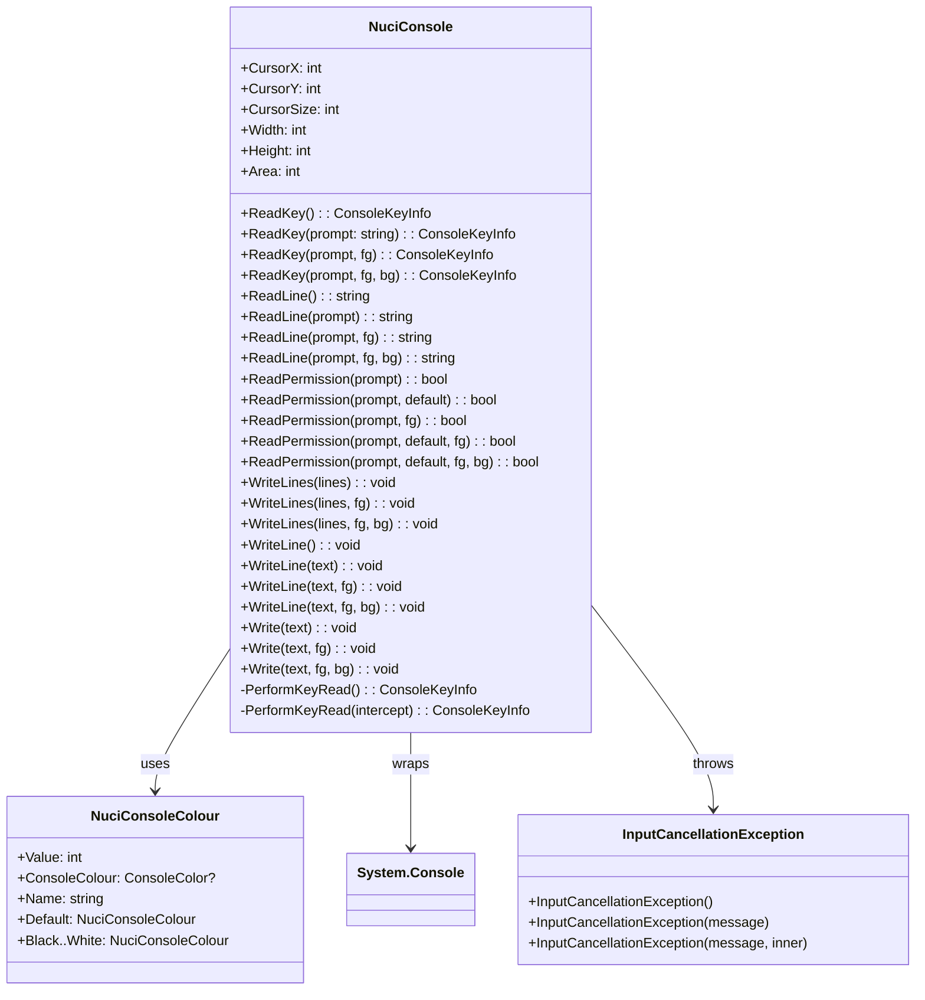

# NuciCLI Architecture (Detailed)

This document elaborates on the root [ARCHITECTURE.md](../ARCHITECTURE.md) with implementation-level detail.

## Architectural Style: Static Façade

NuciCLI implements a **static façade** over `System.Console`. All public members are `static` on two types:

- `NuciConsole` — Main entry point for all console interactions
- `NuciConsoleColour` — Immutable colour value objects mapping to `ConsoleColor`

There is **no instance state**, **no dependency injection**, and **no composition root**. The library is a single assembly (`NuciCLI.dll`) with no internal layering.

## Component Diagram



## Public API Surface

### NuciConsole

All members are `static`. Categories:

| Category | Members |
|----------|---------|
| **Cursor/Buffer** | `CursorX`, `CursorY`, `CursorSize`, `Width`, `Height`, `Area` |
| **Key Input** | `ReadKey()` overloads (4) |
| **Line Input** | `ReadLine()` overloads (4) — throws `InputCancellationException` on Escape |
| **Confirmation** | `ReadPermission()` overloads (6) — Y/N/Enter handling |
| **Output** | `Write()`, `WriteLine()`, `WriteLines()` overloads with colour support |

### NuciConsoleColour

Immutable value type with:
- `Value: int` — numeric code (-1 for Default, 0-15 for ConsoleColor)
- `ConsoleColour: ConsoleColor?` — nullable mapping
- `Name: string` — constant name
- 17 static instances: `Default`, `Black` through `White`

### InputCancellationException

Standard exception with three constructors (default, message, message+inner). Thrown exclusively by `ReadLine()` when user presses Escape.

## Private Implementation

### PerformKeyRead

```csharp
private static ConsoleKeyInfo PerformKeyRead(bool intercept)
{
    bool previousCtrlCBehaviour = Console.TreatControlCAsInput;
    Console.TreatControlCAsInput = true;
    ConsoleKeyInfo inputValue = Console.ReadKey(intercept);
    Console.TreatControlCAsInput = previousCtrlCBehaviour;
    return inputValue;
}
```

Temporarily sets `TreatControlCAsInput = true` so Ctrl+C is returned as a key rather than terminating the process. Restores previous value after read.

## Dependency Direction

```
Consumer App
    │
    ▼
NuciCLI (NuciConsole, NuciConsoleColour)
    │
    ├──► System.Console (BCL) — wrapped
    └──► NuciExtensions — used internally (IsNullOrEmpty checks)
```

No circular dependencies. NuciCLI depends only on BCL and NuciExtensions.

## Runtime Flow

### Key Read Flow
```
ReadKey(prompt, fg, bg)
    │
    ├─► Write(prompt, fg, bg)  // renders prompt
    │
    └─► PerformKeyRead(false)
            │
            ├─► Console.TreatControlCAsInput = true
            ├─► Console.ReadKey(false)
            └─► Restore TreatControlCAsInput
```

### Line Read Flow
```
ReadLine(prompt, fg, bg)
    │
    ├─► Write(prompt, fg, bg)
    │
    ├─► PerformKeyRead(true)  // intercept = true
    │
    ├─► Loop:
    │       ├─► Escape → throw InputCancellationException
    │       ├─► Enter → break, return input
    │       ├─► Backspace → remove char, update cursor
    │       └─► Valid char → append, Console.Write(char)
    │
    └─► PerformKeyRead(true)  // next iteration
```

### Permission Read Flow
```
ReadPermission(prompt, default, fg, bg)
    │
    ├─► Loop:
    │       ├─► ReadKey(prompt + "(Y/n)" or "(y/N)", fg, bg)
    │       ├─► Y → WriteLine(), return true
    │       ├─► N → WriteLine(), return false
    │       ├─► Enter → WriteLine(), return default
    │       └─► Other → CursorX -= 1, continue
    │
    └─► (infinite loop until valid input)
```

### Write Flow
```
Write(text, fg, bg)
    │
    ├─► Save Console.ForegroundColor, BackgroundColor
    ├─► Console.ResetColor()
    ├─► If fg.ConsoleColour != null → Console.ForegroundColor = fg.ConsoleColour
    ├─► If bg.ConsoleColour != null → Console.BackgroundColor = bg.ConsoleColour
    ├─► Console.Write(text)
    ├─► Restore ForegroundColor, BackgroundColor
    │
    └─► (WriteLine adds Environment.NewLine)
```

## Cross-Cutting Concerns

| Concern | Implementation |
|---------|----------------|
| **Thread Safety** | Not thread-safe; `System.Console` is not thread-safe. Caller must synchronize. |
| **Error Handling** | Only `InputCancellationException` thrown. All other errors propagate from BCL. |
| **Cancellation** | Escape key in `ReadLine()` → `InputCancellationException`. No `CancellationToken` support. |
| **Colour Handling** | `NuciConsoleColour.Default` (Value=-1) → `ConsoleColour=null` → no colour change (uses current). |
| **Resource Management** | No resources held. No `IDisposable`. No finalizers. |

## Compatibility Contracts

- **Target Framework**: net10.0
- **NuGet Package**: `NuciCLI` v3.0.2
- **Dependencies**: `NuciExtensions` 6.0.2
- **License**: GPL-3.0-or-later
- **Breaking Changes**: Version 3.x — static façade API stable since v1

## Source Map

| File | Purpose |
|------|---------|
| `NuciCLI/NuciConsole.cs` | Main static façade, all console operations |
| `NuciCLI/NuciConsoleColour.cs` | Immutable colour value objects |
| `NuciCLI/InputCancellationException.cs` | Cancellation exception type |
| `NuciCLI/NuciCLI.csproj` | Project config, dependencies, package metadata |
| `NuciCLI.UnitTests/NuciCLI.UnitTests.csproj` | Test project (NUnit) |

## Related Documentation

- [Root ARCHITECTURE.md](../ARCHITECTURE.md) — High-level overview
- [components/presentation.md](./components/presentation.md) — Presentation layer deep dive
- [components/host-and-composition.md](./components/host-and-composition.md) — Static façade pattern details
- [flows/startup-and-rendering.md](./flows/startup-and-rendering.md) — Initialization and output flows
- [flows/detail-mutation.md](./flows/detail-mutation.md) — Input and mutation flows
- [api-reference/nuci-console.md](./api-reference/nuci-console.md) — Complete API reference
- [api-reference/nuci-console-colour.md](./api-reference/nuci-console-colour.md) — Colour API reference